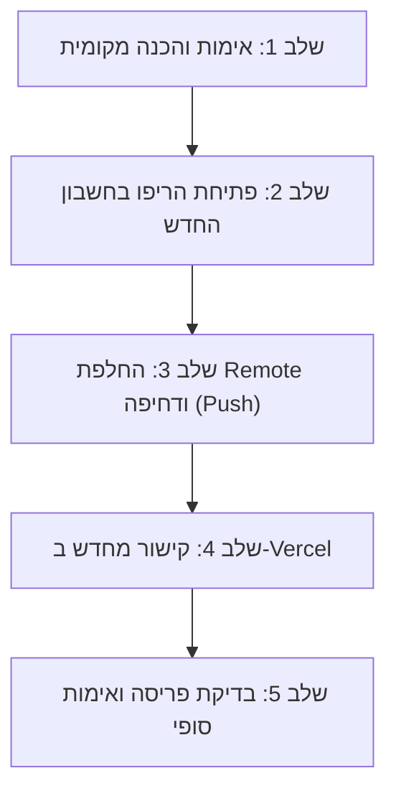

# תוכנית עבודה להעברת פרויקט הבלוג לחשבון GitHub החדש (`aishlomibiz@gmail.com`)

**תאריך יצירה:** 24 באוקטובר 2026  
**סטטוס פרויקט נוכחי:** כל 57 הפוסטים (כולל 2 הפוסטים האחרונים) פורסמו ומסונכרנים בייצור (200 OK). עץ ה-Git המקומי נקי.

---

## 1. רקע ומטרת המעבר

הפרויקט מנוהל כרגע תחת:
* **חשבון GitHub ישן:** `ronenamos-arch` (מייל: `ronenamos@gmail.com`).
* **כתובת ה-Remote הנוכחית:** `https://github.com/ronenamos-arch/ai-world-blog.git`.
* **Vercel Project:** `ai-world-blog` (מקושר כרגע לחשבון `ronenamos-arch`, נתיב בנייה: `00_blog/`).

**המטרה:** העברה מסודרת, מלאה ובטוחה של כל היסטוריית הקוד, הפוסטים, התמונות וההגדרות לחשבון ה-GitHub החדש של `aishlomibiz@gmail.com`, תוך שמירה על רציפות פעילות האתר ב-Vercel וללא השבתה (Zero Downtime).

---

## 2. שלבי הביצוע המפורטים



### שלב 1: אימות מוכנות מקומית (בוצע ✅)
* [x] כל הפוסטים מהשבוע האחרון מסונכרנים ונבדקו ב-Production.
* [x] תיקיית `00_website/` המיותרת נמחקה.
* [x] עץ ה-Git נקי לחלוטין ללא שינויים תלויים (`working tree clean`).

### שלב 2: הגדרת הריפו בחשבון ה-GitHub החדש
1. התחברות ל-GitHub עם החשבון החדש (`aishlomibiz@gmail.com`).
2. יצירת Repository חדש וריק:
   - **שם הריפו:** `ai-world-blog`
   - **חשיפה:** Public (או Private, לפי בחירתך)
   - **חשוב:** **לא** לסמן יצירת README, לא .gitignore ולא License (הריפו חייב להיות ריק לחלוטין כדי שנוכל לדחוף אליו את כל ההיסטוריה הקיימת).
3. קבלת ה-Username המדויק של החשבון החדש ב-GitHub (למשל: `https://github.com/<NEW_USERNAME>/ai-world-blog.git`).

### שלב 3: עדכון הגדרות Git ודחיפה ראשונה (Push)
1. **עדכון פרטי המשתמש בריפו המקומי:**
   ```bash
   git config user.name "AI World"
   git config user.email "aishlomibiz@gmail.com"
   ```
2. **שמירת גיבוי ל-Remote הישן והגדרת ה-Remote החדש:**
   ```bash
   # שמירת הקישור הישן למקרה הצורך (Rollback)
   git remote rename origin old-origin

   # הוספת הקישור לריפו החדש
   git remote add origin https://github.com/<NEW_USERNAME>/ai-world-blog.git
   ```
3. **התחברות לחשבון החדש (אימות הרשאות):**
   - שימוש ב-GitHub CLI: `gh auth login` ומעבר לחשבון החדש, **או** יצירת Personal Access Token (PAT) עם הרשאות `repo`.
4. **דחיפת כל ההיסטוריה והתגיות:**
   ```bash
   git push -u origin main --tags
   ```

### שלב 4: עדכון הקישור ב-Vercel (חיבור CI/CD)
1. כניסה להגדרות הפרויקט ב-Vercel (`ai-world-blog` -> **Settings** -> **Git**).
2. ניתוק הריפו הישן (`Disconnect`).
3. חיבור הריפו החדש תחת המשתמש של `aishlomibiz` (`Connect to GitHub Repository`).
4. אימות הגדרות הבנייה ב-Vercel:
   - **Root Directory:** נשאר `00_blog`.
   - **Framework:** Astro.
   - כל משתני הסביבה (Environment Variables) נשמרים ללא שינוי.

### שלב 5: אימות ובדיקת פריסה חיה
1. ביצוע Commit בדיקה קטן (למשל עדכון README או תאריך).
2. דחיפה ל-`main` של החשבון החדש.
3. אימות ש-Vercel קופץ ומבצע Build ו-Deployment אוטומטי בהצלחה (200 OK).
4. מחיקת ה-`old-origin` מה-Git המקומי.

---

## 3. תוכנית נסיגה (Rollback Plan)

אם במהלך ההעברה תיתקל בבעיית הרשאות בחשבון החדש:
* הריפו הישן ב-`ronenamos-arch` נשאר שלם ומתפקד במאה אחוז.
* ניתן לחזור ל-Remote הקודם בפקודה אחת:
  ```bash
  git remote set-url origin https://github.com/ronenamos-arch/ai-world-blog.git
  ```
* האתר הקיים ב-Vercel ימשיך לפעול ללא כל הפרעה.

---

## 4. מה נדרש ממך כרגע לצורך ביצוע שלב ב'?
1. לוודא שיש לך גישה לחשבון ה-GitHub החדש של `aishlomibiz@gmail.com`.
2. למסור את **שם המשתמש המדויק ב-GitHub (Username)** שנבחר לחשבון זה.
